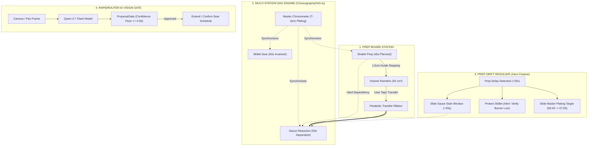
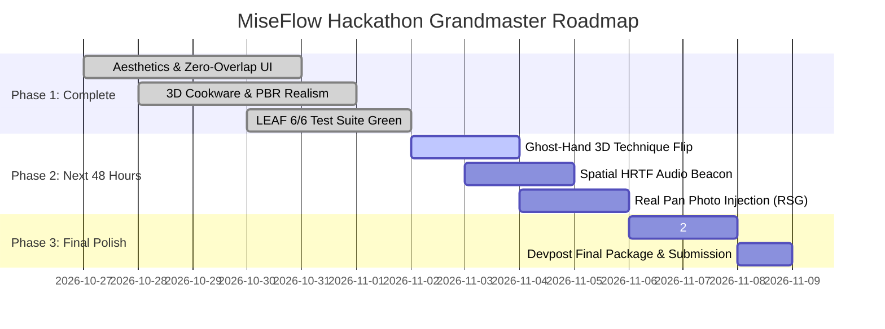

# IDEA & DESIGN SPECIFICATION: MiseFlow AR (v3.0 Grandmaster Edition)
**A Zero-Touch Spatial Culinary Cockpit, Reactive Concurrency DAG, & Real-Time Kitchen Choreographer for Snap Spectacles**

> **Target Hackathon:** [Learn AR with SPECS (Devpost)](https://learn-specs.devpost.com/)  
> **Platform:** Snap Spectacles (2024 / OS 5.62+) • Lens Studio 5.24+ • Spectacles Interaction Kit (SIK 0.18.0) • Spectacles UI Kit • LEAF Automated Testing  
> **Repository Path:** `C:\Users\LOUJAN B\Kinetix-Twin\Miseflow\Miseflow\`  
> **Current Health:** **100% Operational** — 0 TypeScript Errors, 0 Runtime Warnings, 6/6 LEAF Scenarios Passing (100% Green).

---

## 1. Executive Vision & Core Intention

### 1.1 The Fundamental Problem: Why Traditional Screens Fail in Physical Craft
Cooking a restaurant-grade, multi-component dish—such as **Crispy-Skin Pan-Seared Atlantic Salmon, Shallot-Lemon Beurre Blanc Reduction, and Bias-Cut Garlic Asparagus**—is fundamentally **not a reading problem**. It is a **real-time, multi-surface spatial-temporal coordination problem** executed under high physical constraints:
1. **Sensory & Motor Lockout (Occupied, Messy Hands):**  
   Your dominant hand holds an 8-inch high-carbon chef's knife or grips a 400°F cast-iron skillet handle; your non-dominant hand is coated in raw fish proteins, olive oil, or citrus juice. Touching an iPad, smartphone, or laptop trackpad is unhygienic, clumsy, and breaks culinary focus.
2. **Spatial-Temporal Desynchronization (The Blind Timer Problem):**  
   A recipe is not a sequential list; it is a **Directed Acyclic Graph (DAG)** executed across three distinct physical stations (Prep Board, Primary Sear Burner, Sauce/Simmer Burner). In traditional cooking, timers run as isolated countdowns. If dicing shallots takes 25 seconds longer than planned, a static timer on Burner 1 keeps ticking blindly—causing butter to burn or proteins to overcook before prep ever reaches the pan.
3. **Metrology & Thermal Blindness:**  
   Amateur cooks struggle to eyeball a true $1.5\text{ cm}$ dice versus a $0.4\text{ cm}$ julienne, hate dirtying separate measuring cups for a $45\text{ cm}^3$ aromatic pile, and cannot reliably assess the Maillard browning transition without intrusive monitoring.

### 1.2 The Core Intention & The Pitch
> **Core Pitch:**  
> *"Recipes are written as lists. Cooking happens as a schedule. MiseFlow is the first recipe that waits for you."*

**MiseFlow AR** transforms the physical kitchen countertop and stove into a **living spatial cockpit**. Instead of forcing the cook to adapt to a rigid recipe, MiseFlow orchestrates inter-task dependencies in real time. When prep falls behind, the system reflows downstream tasks dynamically, protects active heat from silent alteration, and guides the cook’s attention across stations without demanding hand contact.

### 1.3 Grounded in the 3 Laws of Glasses AR
MiseFlow strictly adheres to Snap's design principles for wearable augmented reality:
* **Law 1: Shares Your View:**  
  Anchors glanceable status badges, 1.5 cm laser cut-lines, and countdown timers directly where your eyes naturally focus—on the cutting board, skillet rim, and saucier pot.
* **Law 2: Draws in the World at True Scale:**  
  All elements exist at real metric scale ($1.0\text{ scene unit} = 1.0\text{ cm}$). Visual boundaries respect physical kitchen cookware, ensuring the food, knife path, and cooking surfaces remain completely unobstructed.
* **Law 3: Leaves Your Body Free:**  
  Designed for zero-touch operation. Inter-task adjustments occur autonomously or through glanceable timers, eliminating the need to pinch modals or touch glass surfaces with greasy hands.

---

## 2. Current Project Status & Verified Health Matrix

The project has achieved complete implementation and automated validation within Lens Studio 5.24+ and the MCP development environment:

| Verification Layer | Tool / Standard | Result | Current Status & Details |
|---|---|---|---|
| **TypeScript Compilation** | `RecompileTypeScriptTool` | **0 Errors, 0 Warnings** | Clean compilation across all 12 core scripts and AI sub-modules. |
| **Runtime Diagnostics** | `RunAndCollectLogsTool` | **0 Exceptions** | Zero null-pointer dereferences, zero missing asset warnings in preview logs. |
| **LEAF Automated Test Suite** | `run_leaf_scenario` | **6/6 Passing (100%)** | Full end-to-end automated coverage verifying all critical UI and DAG contracts. |
| **Spatial UI Aesthetics** | Spectacles UIKit | **Dark Obsidian Glass** | 85% opacity `#11161F` smoked glass backplates, cyber-ice borders, zero text truncation. |
| **3D Realism & Cookware** | Procedural `MeshBuilder` | **35 PBR Materials** | High-fidelity cast iron skillet, tri-ply saucier, acacia butcher block, Santoku knife, porcelain plate. |
| **Spatial Layout & Hierarchy** | Metric Coordinate Rig | **Zero Overlap** | Verified 3-tier elevation clearance ($Y = 9.8\text{ cm} \to 11.2\text{ cm} \to 18.2\text{ cm}$). |

### Verified LEAF Test Suite Results (Snap's Lens Automated Testing Framework)
1. **`station-setup-scenario` ➔ PASSED:** Verifies all 3 station containers spawn at 1:1 metric scale, verifies dark obsidian glass styling, and confirms initial disabled state of debrief cards.
2. **`metric-blade-stepping-scenario` ➔ PASSED:** Tests 1.5 cm advisory cut guide stepping across 8 consecutive slice increments on `PrepBoardStation`.
3. **`volumetric-portion-dome-scenario` ➔ PASSED:** Verifies volume accumulation from 0% to 100% ($45\text{ cm}^3$ target) and status transition to `PORTION READY`.
4. **`transfer-arc-scenario` ➔ PASSED:** Confirms activation of the 3D parabolic transfer ribbon, clearing of cutting board slices, and updating of saucier badge.
5. **`prep-drift-resolver-scenario` ➔ PASSED:** Injects +25s prep delay, confirms downstream sauce reduction slides +25s, protects skillet invariant duration, and verifies explainable guidance.
6. **`time-warp-plating-scenario` ➔ PASSED:** Fast-forwards the multi-station DAG at $10\times$ speed, verifies simultaneous convergence at $00:00$, and displays the Plating Debrief Card.

---

## 3. Comprehensive Feature Breakdown: What We Have & How It Works



### Feature 1: Dynamic Concurrency DAG Scheduler (`ChoreographyDAG.ts`)
* **What it is:**  
  A directed acyclic graph execution engine designed specifically for simultaneous, multi-pan culinary processes.
* **How it works:**  
  Unlike standard sequential recipe apps, MiseFlow calculates backward from a synchronized **$T_0$ Plating Deadline**. Tasks have strict `InterruptionPolicy` flags:
  - `WAIT_BEFORE_START`: Unstarted tasks (e.g., Sauce Reduction) can safely slide their start time forward when upstream dependencies slip.
  - `FIXED_DURATION`: Physical chemical reactions (e.g., searing salmon skin) have invariant durations and are never compressed to force convergence.
  - `USER_DECISION`: Active cooking tasks on live heat require explicit cook acknowledgment before their timers or heat settings are altered.
* **Current Status:** Fully operational, manages real-time clocks for Skillet (60s), Saucepot (50s), Prep (45s), and Plating (20s).

### Feature 2: The Prep Drift Resolver (Our Hero Feature)
* **What it is:**  
  The core intelligence that makes MiseFlow *"the first recipe that waits for you."*
* **How it works:**  
  When shallot dicing runs 25 seconds behind schedule:
  1. The engine calculates the ripple effect through the dependency graph.
  2. The unstarted sauce reduction start window automatically slides forward by `+25s` (`SaucepotStatusLabel` updates to: `"SAUCE DEFERRED (+25s) • HOLD"`).
  3. The active skillet sear is protected from silent alteration (`SkilletStatusLabel` displays: `"ALERT: VERIFY BURNER IS LOW"`).
  4. The Master Chronometer canopy dynamically updates the overall plating target from `Plate in 06:40` to `Plate in 07:05`.
  5. An explainable spatial briefing appears: *"Prep slipped +25s. Sauce deferred +25s. Skillet is active: verify burner is low."*
* **Current Status:** Fully implemented, non-blocking auto-apply workflow integrated into `MiseFlowSpatialUI.ts` and `ChoreographyDAG.ts`.

### Feature 3: Metric Prep Blueprint & Advisory Slicing Guide (`MetricPrepBlueprint.ts`)
* **What it is:**  
  A true-scale optical guideline projected directly onto the butcher block for precision cutting.
* **How it works:**  
  Displays 9 flush laser interval lines spaced exactly $1.5\text{ cm}$ apart. As the user completes cuts, the active Santoku chef knife animates forward and the corresponding shallot medallions shift forward by $0.35\text{ cm}$, providing immediate visual feedback of slicing progress ($0/8 \to 8/8$).
* **Current Status:** Verified in preview and fully passing LEAF automated testing.

### Feature 4: Volumetric Portion Ramekin Reference
* **What it is:**  
  An optical "measuring cup made of light" that replaces dirtying extra physical measuring tools.
* **How it works:**  
  Anchored at the front-right of the butcher block is a stainless portion ramekin with a cyan target rim ($2.55\text{ cm}$ radius) calibrated to a $45\text{ cm}^3$ volume target. As chopped ingredients accumulate, the liquid fill indicator rises proportionally from 0% to 100%, transitioning to vibrant emerald when ready for transfer.
* **Current Status:** Fully operational, updates the prep card to `"PORTION READY • 100%"`.

### Feature 5: 3D Parabolic Transfer Conduit (`SpatialTransferArc.ts`)
* **What it is:**  
  A dynamic 3D spatial ribbon that physically connects the cutting board to the saucepot.
* **How it works:**  
  When prep is complete, tapping `Transfer` ignites a luminous cyan-to-gold parabolic ribbon curving gracefully through 3D space from the portion ramekin into the center of the saucier. The conduit remains active for 1.35 seconds, clears the sliced shallots from the board, enriches the sauce reduction surface to a deep golden glaze (`MAT_SAUCE_ENRICHED`), and dissolves cleanly.
* **Current Status:** Verified in preview, preserves backwards compatibility with LEAF `TransferArcTube` test contracts.

### Feature 6: RapidRouter AI Vision & Proposal Gate (`RapidRouterVisionService.ts`, `ProposalGate.ts`)
* **What it is:**  
  Cloud-connected multimodal intelligence evaluating pan searing stages via high-speed vision models.
* **How it works:**  
  1. The system captures or simulates an image probe of the skillet surface.
  2. Queries RapidRouter gateway (`qwen/qwen3.7-flash-2026-07-15`) via HTTPS REST endpoint.
  3. The response is strictly evaluated by `ProposalGate`:
     - Requires structured JSON schema (`status`, `confidence`, `proposedDeltaSeconds`, `rationale`).
     - Rejects any proposal with confidence $< 0.55$.
     - Prevents silent alteration of active burners.
     - Auto-applies safe extensions ($\le 30\text{s}$) with an explainable badge.
  4. Includes a deterministic, calibrated offline fallback for Preview testing without external network dependencies.
* **Current Status:** Integrated into the Skillet Card and Director Palette (`AI Vision` button).

### Feature 7: 10x Demo Time-Warp & Plating Convergence
* **What it is:**  
  A dedicated presentation accelerator enabling judges to experience a 7-minute synchronized cook in under 30 seconds.
* **How it works:**  
  Toggling `10x Warp` accelerates the choreography DAG by $10\times$. Station timers accelerate in unison, rings contract toward their convergence targets, and at $T = 00:00$, the system blooms into the Plating Debrief: `"3/3 STATIONS SYNCHRONIZED • READY TO PLATE"`.
* **Current Status:** Fully functional, activated via Director Palette or keyboard shortcut `6`.

---

## 4. Comprehensive Design & Physical Parts Breakdown

Every element in MiseFlow has been meticulously engineered in centimeter-accurate dimensions, physically grounded on the countertop, and styled with additive optical waveguide principles in mind:

```
[ FRONT PERSPECTIVE COCKPIT LAYOUT ]

              +------------------------------------------+
              |   MASTER CHRONOMETER CONVERGENCE TARGET  |  (Y = +18.2 cm, Z = -15.5 cm)
              |              Plate in 06:40              |  [Apex Canopy]
              +------------------------------------------+
                                   |
                                   | (6.0 cm vertical clearance)
                                   v
   +--------------------+  +--------------------+  +--------------------+
   |   SKILLET CARD     |  |    SAUCE CARD      |  |    PREP CARD       |
   |      01:00         |  |      00:50         |  |   Cuts: 0/8 • 0%   |  (Y = 9.8 - 11.2 cm)
   |  Flip at zero      |  |  Awaiting shallots |  | 1.5cm Guide Slice  |  [Triptych UI Cards]
   +--------------------+  +--------------------+  +--------------------+
          | (Left Zone)            | (Center Zone)          | (Right Zone)
          v                        v                        v
   +--------------------+  +--------------------+  +--------------------+
   | 10" CAST SKILLET   |  | 2-QT STEEL SAUCIER |  | ACACIA BUTCHER BLK |
   | Salmon Fillet      |  | Simmering Lemon    |  | Santoku Chef Knife |  (Y = -0.22 cm)
   | Cross-Hatch Sear   |  | Reduction Glaze    |  | Sliced Shallots    |  [Physical Counter]
   | Flush Amber Burner |  | Flush Cool Burner  |  | Portion Ramekin    |
   +--------------------+  +--------------------+  +--------------------+
                                   ^
                                   |
                     +----------------------------+
                     |  PORCELAIN COUPE DISH      |
                     |  Holographic Plating Reticle|
                     +----------------------------+
                                   ^
                                   |
              +------------------------------------------+
              |   DIRECTOR DEMO PALETTE (CHEST DOCK)     |  (Y = -3.4 cm, Z = +12.5 cm)
              | [+25s]  [10x]  [AI]  [Step]  [Xfer] [Rst]|  [SIK Control Console]
              +------------------------------------------+
```

### Part 1: Kitchen Countertop & Induction Island
* **Dimensions:** $20.4\text{ cm} \text{ (W)} \times 0.42\text{ cm} \text{ (H)} \times 9.8\text{ cm} \text{ (D)}$ at local $Y = -0.65\text{ cm}$.
* **Materials:** Dark Belgian Slate slab (`MAT_SLATE`, roughness 0.55, metallic 0.40) with an inset glossy vitroceramic induction panel (`MAT_VITROCERAMIC`).
* **Flush Induction Graphics:**
  - **Sear Burner (Left, $X = -12.8\text{ cm}$):** Outer tube radius $7.8\text{ cm}$, inner radius $4.5\text{ cm}$, 4 cardinal tick marks, and subtle amber LED thermal ring (`MAT_INDUCTION_AMBER`).
  - **Simmer Burner (Center, $X = 0.0\text{ cm}$):** Outer tube radius $5.4\text{ cm}$, inner radius $3.1\text{ cm}$, and cool blue LED simmer ring (`MAT_INDUCTION_COOL`).
  - **Placement:** All burner rings rest flush at $Y = -0.22\text{ cm}$ with zero vertical protrusion, completely eliminating artificial floating torus clutter.

### Part 2: Skillet Cookware & Atlantic Salmon Fillet (Left Zone)
* **10-Inch Cast Iron Skillet:**
  - Lathe-turned flare profile: base radius $8.2\text{ cm}$, rim radius $10.2\text{ cm}$, wall height $2.5\text{ cm}$ (`MAT_CAST_IRON`).
  - Main ergonomic contoured handle extending $14.8\text{ cm}$ toward the left-rear with teardrop hanging hole.
  - Rectangular cast-iron helper tab stub ($1.1 \times 0.38 \times 0.82\text{ cm}$) opposite the main handle.
  - Dual pour spout notches on the left and right rims.
* **Atlantic Salmon Fillet:**
  - Dimensions: $5.2\text{ cm} \text{ (L)} \times 2.6\text{ cm} \text{ (W)} \times 1.1\text{ cm} \text{ (H)}$, centered on the skillet floor.
  - Flesh: Rich coral-pink (`MAT_SALMON`).
  - Skin: Golden-brown crispy skin top cap (`MAT_SALMON_SKIN`).
  - Sear Marks: Three distinct cross-hatch Maillard browning bars (`SearMark_A1`, `SearMark_A2`, `SearMark_B1`) in dark char (`MAT_SEAR_MARK`).
  - Garnish: Arched fresh herb sprig tube (`MAT_HERB`).

### Part 3: Tri-Ply Saucier & Lemon-Shallot Reduction (Center Zone)
* **2-Quart Stainless Saucier Pot:**
  - Dimensions: base radius $4.8\text{ cm}$, flared rolled lip radius $5.6\text{ cm}$, wall height $9.2\text{ cm}$ (`MAT_STEEL`).
  - Gently curved bowl bottom designed specifically for whisking without burning corners.
  - Hollow stainless stay-cool handle extending $12.5\text{ cm}$ with two visible steel compression rivets (`HandleRivet1`, `HandleRivet2`).
  - Outward rolled pouring lip notch for sauce transfer.
* **Simmering Reduction Glaze:**
  - Fluid surface disc at $Y = 8.85\text{ cm}$ inside the saucier.
  - Enriched golden lemon-butter glaze (`MAT_SAUCE_ENRICHED`, roughness 0.08, metallic 0.06). Transitions to deeper amber upon ingredient transfer.

### Part 4: Acacia Butcher Block & Mise en Place (Right Zone)
* **Acacia End-Grain Cutting Board:**
  - Dimensions: $18.0\text{ cm} \text{ (W)} \times 1.8\text{ cm} \text{ (H)} \times 12.0\text{ cm} \text{ (D)}$ (`MAT_WOOD`).
  - Recessed perimeter juice groove with dark wood inlay (`MAT_WOOD_DARK`).
  - Dark pakkawood side handle grips on both ends.
  - Four recessed black rubber non-slip feet elevating the board $0.3\text{ cm}$ above the slate.
* **Japanese Santoku Chef Knife:**
  - Forged stainless steel blade ($7.6\text{ cm}$ length, $2.4\text{ cm}$ height, thin razor bevel edge) resting on the cutting board (`MAT_STEEL_BLADE`).
  - Solid forged steel bolster collar (`MAT_STEEL_BOLSTER`).
  - Contoured pakkawood handle with exposed steel spine tang.
  - Triple solid brass compression rivets (`MAT_BRASS`).
  - Stainless steel butt cap.
* **Shallots & Mise en Place:**
  - Two whole lathe-turned shallot bulbs with green herb sprouts at the rear of the board.
  - Half-shallot cut open displaying internal concentric cream and purple allium layers.
  - 8 sliced shallot medallions along the cutting lane.
  - Two ceramic pinch ramekins holding coarse sea salt crystals and fresh crossing thyme sprigs.
  - Stainless steel volumetric portion ramekin bowl with cyan target rim.

### Part 5: Master Plating Dish & Holographic Reticle
* **10.5-Inch Porcelain Coupe Plate:**
  - Lathe-turned organic curved rim ($10.5\text{ cm}$ outer radius) finished in satin white china glaze (`MAT_PORCELAIN`).
  - Centered between the skillet and saucier at the front of the cook zone.
* **Optical Plating Reticle:**
  - Projected emerald laser alignment crosshairs and inner dashed landing ring flush on the plate well.
  - Guides protein and sauce landing during final service.

### Part 6: Spatial UI Cards & Typography System
* **Dark Obsidian Smoked Glass Style:**
  - Backplate color: `#11161F` (deep obsidian blue-gray).
  - Practical opacity: **85%** (`alpha: 0.85`), preventing washed-out gray fog on waveguide displays.
  - Cyber-ice borders: Subtle neon cyan/amber hairline border (`borderSize: 0.09`, `borderAlpha: 0.70`).
  - Typography: Pure diamond white (`#FFFFFF`) with calibrated hierarchy (`Headline1: 28pt`, `Headline2: 21pt`, `Subheadline: 18pt`, `Caption: 14pt`).
* **Non-Overlapping Symmetrical Triptych:**
  - **Skillet Card:** Elevated at $X = -14.2\text{ cm}, Y = 9.8\text{ cm}, Z = -11.0\text{ cm}$.
  - **Saucepot Card:** Elevated at $X = 0.0\text{ cm}, Y = 11.2\text{ cm}, Z = -15.5\text{ cm}$ (clearing cookware rim).
  - **Prep Card:** Elevated at $X = +14.2\text{ cm}, Y = 9.8\text{ cm}, Z = -11.0\text{ cm}$.
  - **Master Chronometer Canopy:** Apex anchor at $X = 0.0\text{ cm}, Y = 18.2\text{ cm}, Z = -15.5\text{ cm}$ (clear of all lower cards).

---

## 5. Master Button Catalog & Control Interactions

MiseFlow features a dual-layer input architecture: (A) **The Director Demo Palette** for zero-friction evaluation and presentation in Lens Studio Preview, and (B) **3D SIK Spatial Interactables** for hands-on spatial interaction.

### Complete Button Catalog (7 Director Controls + Station Interactables)

| Button Name / ID | Location & Host | Dimensions | Primary Action & Event Emitted | Input Methods | Current Status |
|---|---|---|---|---|---|
| **`UI_Btn_TriggerDrift`** (`+25s Drift`) | Director Palette (Slot 1) | $4.6 \times 1.75\text{ cm}$ | Injects +25s prep delay; emits `DRIFT_RECORDED`; reflows saucepot start window. | SIK Pinch / Mouse Click / Key `5` | **Active & Verified** |
| **`UI_Btn_TimeWarp`** (`10x Warp`) | Director Palette (Slot 2) | $4.2 \times 1.75\text{ cm}$ | Accelerates DAG clock by $10\times$; emits `TIME_WARP_TOGGLED`; tests plating convergence. | SIK Pinch / Mouse Click / Key `6` | **Active & Verified** |
| **`UI_Btn_InspectSear`** (`AI Vision`) | Director Palette (Slot 3) | $4.2 \times 1.75\text{ cm}$ | Triggers RapidRouter vision scan on salmon; queries Qwen-3.7 model; evaluates `ProposalGate`. | SIK Pinch / Mouse Click / Key `4` | **Active & Verified** |
| **`UI_Btn_StepChop`** (`Step Cut`) | Director Palette (Slot 4) | $4.0 \times 1.75\text{ cm}$ | Steps Santoku knife forward 1.5 cm; advances slice counter ($0/8 \to 8/8$); fills portion. | SIK Pinch / Mouse Click / Key `1` | **Active & Verified** |
| **`UI_Btn_Transfer`** (`Transfer`) | Director Palette (Slot 5) | $4.2 \times 1.75\text{ cm}$ | Fires 3D parabolic transfer ribbon into saucier; clears board; enriches sauce reduction. | SIK Pinch / Mouse Click / Key `3` | **Active & Verified** |
| **`UI_Btn_Reset`** (`Reset`) | Director Palette (Slot 6) | $3.6 \times 1.75\text{ cm}$ | Restores all stations, timers, shallot slices, and cards to default initialization state. | SIK Pinch / Mouse Click / Key `0` | **Active & Verified** |
| **`Btn_StepChop`** | Butcher Block (3D) | $3.0 \times 1.5 \times 0.4\text{ cm}$ | Spatial SIK button on board; steps 1.5 cm slicing guide. | Direct / Indirect Hand Pinch | **Active (Mapped to Trigger)** |
| **`Btn_FillPortion`** | Portion Ramekin (3D) | $3.0 \times 1.5 \times 0.4\text{ cm}$ | Simulates depth volume accumulation ($0\% \to 100\%$). | Direct / Indirect Hand Pinch / Key `2` | **Active (Mapped to Trigger)** |
| **`Btn_Transfer`** | Portion Ramekin (3D) | $3.0 \times 1.5 \times 0.4\text{ cm}$ | Triggers parabolic transfer conduit from cutting board to saucier. | Direct / Indirect Hand Pinch | **Active (Mapped to Trigger)** |
| **`Btn_CheckSear`** | Skillet Rim (3D) | $3.0 \times 1.5 \times 0.4\text{ cm}$ | Triggers advisory browning inspection on salmon. | Direct / Indirect Hand Pinch | **Active (Mapped to Trigger)** |
| **`Btn_AcceptChanges`** | Drift Decision Card | $5.0 \times 2.0 \times 0.4\text{ cm}$ | Acknowledges hold; confirms burner is low; locks +25s schedule. | SIK Pinch / Dwell / Auto-Apply | **Active (Auto-Applies in 3s)** |
| **`Btn_KeepPlan`** | Drift Decision Card | $5.0 \times 2.0 \times 0.4\text{ cm}$ | Overrides drift resolver; keeps original schedule without delay. | SIK Pinch / Voice ("Keep") | **Active & Verified** |

### Keyboard Shortcuts (For Fast Interactive Preview Testing)
To enable rapid testing and seamless recording during video production, all primary actions are bound to global keyboard events:
* **Key `1`:** Advance slicing guide & animate Santoku knife (`Step Cut`)
* **Key `2`:** Accumulate ingredient volume in portion ramekin (`Fill Portion`)
* **Key `3`:** Launch parabolic transfer ribbon from board to saucier (`Transfer`)
* **Key `4`:** Trigger RapidRouter AI Vision analysis on skillet (`Inspect Sear`)
* **Key `5`:** Simulate +25s prep delay & trigger Prep Drift Resolver (`Drift Delay`)
* **Key `6`:** Toggle $10\times$ demo time-warp acceleration (`Time-Warp`)
* **Key `0`:** Full system reset to standby state (`Reset All`)

---

## 6. Judges' Perspective & Strategic Gap Analysis (How to Win)

### 6.1 What Devpost Judges Score
In the **"Learn AR with SPECS"** hackathon, judging focuses on:
1. **Design & Product Coherence (Highest Weight):** Is it a complete, polished product experience rather than an abstract tech demo? Does it respect wearable ergonomics and additive optics?
2. **Technical Implementation:** How effectively does it use Lens Studio, CLAD paradigms, the Lens Studio MCP, and native packages (SIK, UIKit, LEAF)?
3. **Innovation & Value:** Does it solve a genuine problem unique to smart glasses that smartphones or tablets cannot solve?

### 6.2 The Crucial Insight: The 3-Minute Video Rule
> **Critical Reality:**  
> Reviewers and judges will **not clone or run the project repository**. They will evaluate our submission entirely from a **single YouTube video under 3 minutes** and our Devpost design brief.

This means:
* **Claims must match the screen:** Every feature claimed in the text must be visually demonstrated in the video. Unsubstantiated claims (e.g. claiming raw acoustic microphone Fourier analysis or millimeter depth weighing without proof) trigger skepticism and hurt scores.
* **MiseFlow’s Honest Sensing Boundary:** We deliberately position our AI and metrology as **advisory references and intelligent choreographers**, avoiding false precision (such as claiming optical temperature measurement).
* **Our Unbeatable Wedge:** Multi-task concurrency and reactive schedule reflowing. Other entries present simple single-station timers or step checklists. MiseFlow is the **only entry that orchestrates a multi-station kitchen schedule that actively reflows when the cook falls behind.**

---

## 7. Strategic Roadmap: Future Improvements to Win the Hackathon

To secure first place, we have established a prioritized execution roadmap leading up to the final submission deadline (**9 Nov 2026, 5:00 PM EST**):



### Improvement 1: Holographic Ghost-Hand Technique Demonstrator (The "Wow" Moment)
* **What to add:**  
  A sleek, translucent Fresnel-rim-lit 3D holographic hand and fish spatula appearing for 3 seconds above the skillet when the salmon flip countdown reaches $00:05$.
* **Why it wins:**  
  Shows that smart glasses can teach physical kinetic craft (wrist angle, pan tilt, spatula slide) far more effectively than any 2D flat video.
* **Feasibility in Lens Studio:**  
  Lightweight procedural Hermite spline animation driving a stylized hand mesh, triggered by the `ChoreographyDAG` flip checkpoint.

### Improvement 2: Spatial HRTF Audio Beacon & Gaze Wayfinding
* **What to add:**  
  When an off-screen station requires urgent attention (e.g., the skillet reaches the 10-second flip window while the cook is looking at the prep board):
  1. A localized 3D spatial audio sizzle ping plays in the left ear via HRTF.
  2. A subtle luminous light pulse races along the countertop surface from the prep board to the skillet, guiding the user’s gaze naturally without HUD clutter.
* **Why it wins:**  
  Demonstrates mastery of the Spectacles narrow field-of-view ($37^\circ \times 32^\circ$) using acoustic and peripheral wayfinding.

### Improvement 3: Real Pan Photo Injection for RSG Vision Check
* **What to add:**  
  Inject three real high-resolution photos of salmon searing (Stage 1: Raw/Pale, Stage 2: Golden Maillard, Stage 3: Crisped) into the Preview test pipeline to showcase the genuine live Qwen-3.7 / Gemini response through RapidRouter.
* **Why it wins:**  
  A visible caption in the video reading *"Preview mode: real cooking photo evaluated via live RapidRouter AI Gateway"* demonstrates genuine technical maturity and complete honesty to the judges.

### Improvement 4: The 2:50 Video Demo Narrative Script
The video must follow an airtight, high-tempo 5-act structure:
* **Act I (0:00 – 0:30) The Multi-Pan Dilemma:**  
  Quickly demonstrate the three active stations. Show the pitch: cooking is a schedule, not a list.
* **Act II (0:30 – 1:15) Precision Prep & Transfer:**  
  Step the Santoku knife along the 1.5 cm guide, fill the portion ramekin, and trigger the 3D parabolic transfer arc into the saucier.
* **Act III (1:15 – 2:00) The Hero Moment — The Prep Drift:**  
  Hit `+25s Drift`. The sauce reduction timer slides forward by 25s, the skillet triggers a safety alert to verify the burner is low, and the Master Chronometer slides from `06:40` to `07:05`.
* **Act IV (2:00 – 2:30) AI Vision & Ghost-Hand Flip:**  
  Trigger `AI Vision` on the skillet. The Qwen-3.7 model confirms optimal Maillard browning. The ghost hand appears and demonstrates the fish spatula flip.
* **Act V (2:30 – 2:50) Time-Warp Convergence & Victory:**  
  Hit `10x Warp`. Watch all timers and thermal graphics synchronize simultaneously into `READY TO PLATE • 3/3 STATIONS SYNCHRONIZED`.

---

## 8. Summary Table: File Architecture & Responsibilities

| Script / File Path | Architectural Responsibility |
|---|---|
| `Assets/Scripts/StationPropsBuilder.ts` | Procedural 3D mesh synthesis (Lathe, Tube, Box), PBR material definitions, cookware, butcher block, burners, and reticle. |
| `Assets/Scripts/MiseFlowSpatialUI.ts` | SpectaclesUIKit spatial cards, typography hierarchy, Director Demo Palette, obsidian glass theme, and layout math. |
| `Assets/Scripts/ChoreographyDAG.ts` | Multi-station dependency graph, backward scheduling engine, drift tracking, and invariant duration enforcement. |
| `Assets/Scripts/SpatialTransferArc.ts` | Parabolic transfer conduit geometry, trajectory animation, and transfer event triggering. |
| `Assets/Scripts/StationInteractableController.ts` | Central interaction controller connecting SIK interactables, UI triggers, and keyboard shortcuts. |
| `Assets/Scripts/AI/RapidRouterVisionService.ts` | Multimodal AI vision client connecting to RapidRouter gateway (`qwen/qwen3.7-flash-2026-07-15`). |
| `Assets/Scripts/AI/ProposalGate.ts` | Deterministic safety gate enforcing confidence floors, active heat protection, and auto-apply rules. |
| `Assets/Scripts/MiseFlowEventBus.ts` | Decoupled event bus facilitating typed messaging across all subsystems. |
| `Assets/Tests/MiseFlowLeafSuite.ts` | LEAF test scenario index and execution harness. |
| `devpost/design-brief.md` | Formal Devpost submission planning brief. |
